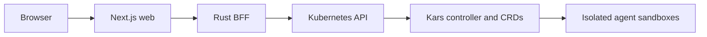

<!-- Copyright (c) Microsoft Corporation.
Licensed under the MIT License. -->

# Kars Bridge

**Mission control for governed agent work.**

Kars Bridge is a human-facing experience layer on top of
[Kars](https://github.com/Azure/kars). Employees launch missions and standing
teams; operators govern providers, MCP servers, skills, egress, budgets, and
approvals; auditors inspect receipts and evidence.

> **Status: integration preview.** The complete application lives in `bridge/`
> in the Kars repository, initially on the `kars-bridge` branch. Source publication
> is not a release, an image publication or a production support commitment.
> Build images in your own registry and configure the chart explicitly.

## Product boundary

**Bridge depends on Kars; Kars never depends on Bridge.**

Bridge owns composition, workflows, visualization, and personas. Kars owns the
CRDs, controller, sandbox isolation, inference router, policies, encrypted mesh,
and durable evidence. Every Kars primitive remains usable without Bridge.
The BFF keeps an independent Cargo manifest and lockfile and is excluded from
the core workspace. Web and Teams gateway retain their own npm packages.
Bridge uses its own additive Helm release; removing it must preserve Kars
resources and customer data. Repository co-location does not change this boundary.

Private-bound Bridge upgrades retain exact UID/resource-version/replica fences and
unchanged BFF/Teams execution. A controller-managed credential rollout in another
qualified sandbox does not require repeating migration: the chart verifies its
existing projector receipt against the original template baseline, current
structure/template, namespace ownership, and live KarsSandbox UID/generation.
Missing or stale receipts and unrelated execution changes still block publication.

Reviewed HTTP fetches must be covered by the package's proposed egress hosts and
ports. Mission and Team composition return mismatches to the model's existing
repair attempt; preflight and Bridge activation reject unresolved mismatches.
These checks never add permissions. Domain coverage preserves the router's
parent-domain matching (for example, `freshworks.com` covers its subdomains but
not `freshdesk.com`). Coverage and DNS checks do not prove sandbox reachability
or successful retrieval of the required sources.

Readiness checks in Mission and Team editors use the same-origin `/api/preflight`
endpoint rather than build-specific Server Action identifiers, so subsequent web
rollouts do not invalidate that check in an already-open editor. The endpoint reuses
the existing authenticated validators and deployment namespace; it does not change
spending limits, grant permissions, create work, or start a run. Failed checks keep
the draft in place and do not retain an earlier successful validation. This does
not migrate tabs loaded before the stable endpoint was introduced or make other
Server Actions rollout-independent; preserve those drafts before refreshing.

## Start here

| Goal | Documentation |
|---|---|
| Understand the product | [Documentation home](docs/README.md) |
| Install the integration preview | [Quickstart](docs/quickstart.md) |
| Review Kars compatibility | [Compatibility](docs/compatibility.md) |
| Configure identity and roles | [Identity](docs/identity.md) and [RBAC](docs/rbac.md) |
| Run missions and teams | [Missions and teams](docs/missions-and-teams.md) |
| Understand the full team/run/evidence flow | [Team workflows](docs/team-workflows.md) |
| Add Playwright or another MCP | [MCP servers](docs/mcp-servers.md) |
| Govern skills and approvals | [Skills](docs/skills.md) and [approvals/egress](docs/approvals-egress.md) |
| Deploy local GPU models | [Local inference](docs/local-inference.md) |
| Diagnose a failure | [Troubleshooting](docs/troubleshooting.md) |

## Surfaces

| Surface | Persona | Purpose |
|---|---|---|
| Workspace | User, operator, admin | Compose and review missions, teams, connections, and deliverables |
| Operator Console | Operator, admin | Providers, models, policies, MCP, skills, approvals, fleet health, budgets |
| Audit | Auditor, admin | Read-only receipts, evidence, and verification |

These are separate persona boundaries. Workspace links do not depend on Console
routes, and Audit is self-contained.

Audit separates **recorded claims**, **whole-log integrity**, and **per-receipt
cryptographic checks**. "Claims pass" requires passing integrity, conformance,
and completeness claims; a missing or omitted required claim remains partial.
Only regulatory maturity is advisory. A recorded log position is not membership
proof, and a valid checkpoint does not verify each receipt or prove that controls
were enforced. Expand a receipt and select **Verify now** to inspect its checks
and evidence. Cluster-published anchors share the log's trust domain; even a
pinned signature does not establish snapshot freshness. Witness metadata is
shown separately from verified evidence.

Safety eval summaries describe whether cases matched their declared expectations,
not whether every failed case was an unblocked attack. A blocked request can
still fail policy-attribution, reason, or required-observation checks. Inspect
the detailed report's expected/actual decisions and failure reason before
diagnosing a policy bypass; errored cases remain inconclusive.

Safety evaluation creation accepts either a canonical built-in corpus name
(e.g. `jailbreak-baseline`) or its displayed `builtin:` form. Both select the
same evaluation and persist the canonical name. Unknown names are rejected
before any cluster write, using the catalogue shared with the packaged corpora.
Existing malformed evaluations and their historical failures are not rewritten.

## Architecture



- The browser never receives Kubernetes credentials.
- The BFF verifies the signed Bridge principal and applies persona checks.
- The BFF ServiceAccount is the aggregate Kubernetes permission ceiling.
- Kars controllers and routers remain the runtime enforcement layer.

## Qualification

### Native Activity coverage

The Activity reader accepts retained mission protocols v1–v4 and current v5
peer-context replies. V5 retains reviewed phase/output validation and validates
the bounded peer roster; live and efficiency evidence must also match the
candidate and assignment's exact peer context. A recorded roster is not proof
of delivery or peer agreement. Task ownership, revision and commit checks still
apply before any retained result is shown.

The existing revision-pinned Activity stream also publishes provisional observations
for the controller's reserved specialist phases, not just the principal. Each poll
revalidates the root, role and phase ownership/specification and reservation map;
each phase has an independent append-only attempt pin. The graph, timeline and
Rounds & tools share that stream. Disconnects hide provisional observations,
custody regressions revoke them, and terminal records take precedence. Bounded
streams renew without losing browser custody pins. A failed sibling does not stop
observation or page refresh while another reserved phase is still running.
Provisional observations never establish completion, usage totals, downloadable
artifacts, reviewability or successful delivery.

Failed reviewed phases without committed output can expose `failure_diagnostic`
from the same custody- and revision-validated attempt used for phase state. This
optional field is separate from `result`: the known native per-round usage count
mismatch exposes only bounded numeric counts, while other recorded errors receive
a fixed sensitive-details-withheld message. Raw provider errors, attempt output
and artifacts are not published by this path. Committed results take precedence;
active, stopped, uncertain and mismatched attempts expose no failure diagnostic.
The Team run failure panel, phase details and timeline use this diagnostic without
promoting partial work to delivery or treating these counts as verified usage.
For committed failed phase results, these views use only the recorded `error`,
never generated `output` as diagnosis. The raw result remains retained for evidence
inspection; missing error text is not replaced with generated success claims.

Teams and Missions share the Activity execution overview. For multi-agent runs,
it initially shows recorded counts across the principal and reserved phases,
identifies missing traces, and links each producer and the latest timestamped
action to its exact drill-down. Worker calls are never attributed to the principal;
selecting that node still shows only its own records. Counts describe available
records, not complete execution totals. Untimestamped records cannot establish a
newest action across producers. The recorded timeline is newest-first, with ties
grouped by producer and descending sequence; untimestamped records follow in
producer groups, descending sequence without inferred cross-producer chronology.
Legacy round/tool groups follow their latest record, with newest tools first.
Canonical evidence order and custody pins remain unchanged. Execution-flow cards
keep source and outcome summaries visible; expandable **Arguments and provenance**
retain argument-preview caveats and producer bindings. Search includes collapsed
details. Long payloads wrap within the card, including on narrow screens. The
shared recorded timeline also wraps long tool names and stacks timestamps above
the record on narrow screens, keeping disclosures and search within the panel.

After an explicit stop, task detail and reviewed phases expose `stopped_activity`
when the unfinished attempt still passes the same identity, contract and journal
checks. Reloading shows these last recorded partial observations, including the
recorded runtime and model, without a live pulse or a completion claim. They do
not enter final usage totals or grant artifact downloads. Terminal evidence takes
precedence; a new revision, changed custody or resumed active phase cannot reuse
this stopped snapshot as live progress.

Recent runs labels an unfinished direct Mission **Stopped** only after its run
was acknowledged, Stop is explicit, and the current generation has reconciled to
`Idle` without a sandbox. Reviewed direct Missions must still pass their reviewed
state custody checks. Missing or changed custody stays unavailable; Team phase
outcomes and matching delivered/error outputs retain precedence.

A stopped, completed reviewed Mission cannot relaunch its consumed revision.
When launch validation returns `CompletedReviewedRun`, Overview shows **Completed
revision**, not a fixable launch failure or a Recheck button. Output, review and
accounting remain retained. Continue through **Request changes** in Deliverable,
then review and launch the distinct revision from Overview; this does not resume
an old process or replay its completed phases. The page only confirms that the
runtime is stopped after observing `Idle`; otherwise it says shutdown was requested.

Activity retains the existing Hermes `returned-responses-only` contract: `responses`
counts returned responses, and tool results require a later selected `reported_in_round`.
Native OpenClaw Activity instead uses `native-tool-correlated-only` with
`correlated_tools` (1–256), no `responses` field, and only individually correlated
call IDs/names and their actual accepted proposing rounds (at most 130).
The BFF and browser accept the same retained limit of 1,024 Activity events;
growing valid traces do not disappear at the former 256-event browser boundary.
Each result must match a unique prior proposal's ID, name and proposing round;
immediate `harness-reported` results omit `reported_in_round`, rather than inventing
a response ID or later reporting round. Native file-read/write summaries retain
only bounded byte counts, truncation and safe artifact names, never raw contents.

Correlated `router_operation` events retain actual router tool-policy decisions
(`governance` or `rate_limit`), egress-policy checks (`egress_check`,
`private_target`, `dispatch_recheck`) and fetch observations (`response`,
`body_error`, `transport_error`). Flags identify the check/result, not a policy
rule ID or an inferred security verdict. Destination fields contain only host
and port; URLs, paths, query strings, headers and content are excluded.
OpenClaw native `web_fetch` carries its admitted call identity through every
redirect; native Mission HTTP tools in both runtimes use the same router path.
The router binds observations to a live matching proposal; fetch correlation
also requires existing tool authorization. Uncorrelated traffic remains outside
Mission/Team selections. Router records and harness results are separate: HTTP
status never implies policy permission, agent honesty or Mission completion.

Team Research & egress aggregates these bound observations from the principal
and current reviewed roles, including failed roles. It deduplicates by producer
and observation identity and retains policy/fetch flags separately. Native
records show destination host/port without inventing source URLs or timestamps;
legacy router HTTP evidence retains its existing links. Missing observations do
not establish absent traffic, and egress observations alone do not prove useful
research, harness success or complete coverage.

The artifact version remains 1 with an additive event kind. Older artifacts
remain valid but cannot acquire historical flags; missing flags are unavailable,
not allow/deny. Package the router, OpenClaw/Hermes runtime and Bridge BFF/web
together before live acceptance: old BFFs reject the new event kind. No retained
artifact migration or backfill is performed.

Observed native snapshots require exact proposal counts and round coverage, no
missing rounds, dropped events or truncation. Reset, expiry, truncation or read
failure yields the fixed unavailable reason: `Native tool-correlated observations
unavailable (reset, expiry, truncation or read failure)`. Live monotonicity pins
coverage and its corresponding count, alongside the existing producer, attempt,
scope, current Task UID, run nonce and custody checks.

The UI distinguishes correlated-tool counts from response counts and immediate
harness reports from later reporting rounds. Native coverage excludes model-only
rounds, final responses and uncorrelated calls; neither coverage is independent
proof of execution, artifact authorship, approval or complete run telemetry.

### Efficiency evidence

`/api/efficiency` and compose share one model × harness frontier. Modern usage
and rounds come from the validated terminal `evidence.json`, not absent flattened
fields. Historical harness and repeat identity come only from the same retained
attempt's custody-checked candidate, assignment, and terminal journal. Repeat
keys hash the complete input and reviewed contract; today's Task objective and
200-character prefixes are not repeat evidence. Retained measurements do not
establish historical provider identity. When multiple configured providers share
a deployment name, that name's history stays visible in Insights but is excluded
from composer recommendations, prompts, scoring and per-route token estimates.
Explicit provider/model choices remain valid; they are not endorsed by ambiguous
history. When composition strengthens a multi-role Team's principal, inherited
member routes are resolved against the original principal before the upgrade;
explicit member models and proposed budgets are preserved. Principal promotion
does not promote every worker or qualify any route. The existing route
qualification and live budget-contract checks still apply to the resulting
proposal. Resolving a unique catalogue entry is not proof of historical provider
execution or multi-provider qualification.

Ordinary Mission workers inherit the principal's runtime, provider and model;
execution-plan roles do not carry route overrides. Role names and composer
rationale cannot assign cheaper models or different harnesses. Mixed-provider or
cross-runtime role assignments require a Team's explicit per-role configuration.
Mission composition must disclose this limitation rather than silently dropping
a requested heterogeneous roster. Model fallbacks are not per-role assignments.

Team revision inputs are hydrated only from retained producers in the same Team,
backlog UID and work item. The reader uses the shared Team work binding contract
(`backlog_uid`, `item_id`, `request_digest`), not a separate JSON field convention.
A revision may have a new request digest without changing work custody; source
Task/run identities, retained evidence and exact artifact bytes remain checked.

Human acceptance belongs only to the reviewed Task UID and run nonce; approving
a parent does not approve its specialist phases. Team outcomes reuse the
controller's retained work journal: only `approved` entries bound to the same
Team/backlog ownership, work item, Task UID, nonce, completion timestamp and raw
output-map digest count. Unreviewed `completed` entries do not count, and later
work-item edits do not erase prior bound approvals. The output digest is captured
before presentation metadata is added. Legacy rows remain visible with
their verified-run count but cannot select an execution route. Unknown metrics
are `null`/`—`, including whole-run tool counts when only partial router activity
exists. Terminal phase counters provide measured tool attempts/failures; modern
wall time is terminal start-to-finish, not inferred compute time. Cache and
time-to-first-action remain unknown without complete measurements.
Inventory, review, attempt, and trace read failures return an explicit upstream
error to both Insights and compose; they are not empty history or zero acceptance.
Genuinely absent optional records retain unknown measurements.

Token and configured-price costs are per **measured delivered** run, not accepted
outcome or total spend. `measured_token_runs` supplies coverage and
`measured_tokens` supplies the actual delivered-token subtotal. Recommendations
require validated history, a recorded harness, and complete delivered-token
coverage; ranking is acceptance, repeated-package reliability, delivery, then
token cost, with the exact selected pair and sparse-evidence caveats retained.
This is descriptive retained evidence, not a controlled model benchmark or live
qualification.

The Bridge CI workflow checks the BFF, web, Teams gateway, dependency locks,
security configuration and additive install/removal behavior. The native
workflow checks the application and core from the **same immutable monorepo
commit**. Component checks, older demonstrations and API-only admission are not
substitutes for full native acceptance.

This integration candidate is not yet a qualified release. Credential lifecycle,
observer access and complete governed Team execution must satisfy their
applicable acceptance gates before a release claim. See
[Compatibility](docs/compatibility.md) for the scope of the evidence.

Mission and Team composers read the live operator inference-budget contracts before
proposing budgets. The prompt distinguishes per-request reservation capacity from
expected usage and includes input/output bounds, cumulative usage and role/lifetime
headroom. It includes a live numeric lower bound for each role independently, not
an aggregate to divide among workers. An impossible Mission or role cap triggers the existing single model
repair attempt using the same necessary-condition check as preflight. That attempt
receives structural/egress failures and all independently evaluable role-budget
failures together, rather than hiding one behind another. It also receives the
installed executor's activation diagnostic, including insufficient tool-call
allowances. Unsupported requirements remain reviewable launch blockers, not
permission to drop necessary work. Model-composed Missions must retain a finite
positive aggregate cap; manual uncapped review semantics are unchanged. Caps are
not silently enlarged or made unlimited. Repair-call failures retain their actual
cause and original proposal diagnostics; truncated provider responses are not
accepted as complete packages. Mission and Team package generation and their single
repair attempt each request at most 8,192 output tokens, including reasoning on
OpenAI-compatible routes, through the same governed router and lifetime account.
A received but rejected repair retains the model's rationale for diagnosis while
withholding the invalid proposal. OpenAI-compatible
composer requests require JSON-object response mode, preserved as `text.format`
when the router translates to Responses; unsupported-format errors are not retried
in unconstrained text mode. JSON mode does not replace package or budget validation.
The native Anthropic request remains unchanged. These proposals do not fund an account or
prove exact provider/endpoint coverage. Team roles still share the existing Team
UID lifetime cap, and launch-time admission remains authoritative.

### Model defaults

Configuration's **Set as default** and provider promotion save a provider-qualified
selection in the enrolled `kars-inference-providers` Secret's
`kars.azure.com/default-model` annotation. They preserve credentials and catalogs,
use UID/resourceVersion compare-and-swap, and do not change the sealed controller
pod template. New Bridge missions and teams inherit the saved selection through
the shared launch palette; existing explicit routes are unchanged. Controller
bootstrap defaults for raw/CLI-created resources and an existing standing
orchestrator's explicit policy are separate and are not rewritten by this action.
Starting Mission or Team composition selects the configured provider-qualified
default before model-quality or efficiency rankings and configures the standing
orchestrator for that request. Rankings are a fallback only when no eligible
configured default exists.

If the saved model becomes unavailable, normal launches reject the stale default.
Configuration still exposes the available catalog so the operator can select a
replacement, with the load error visible rather than silently using another model.

### Standing orchestrator lifecycle

Mission and Team composition select among configured orchestration-capable models.
The quality heuristic distinguishes GPT-5.4-mini from full GPT-5.4; the mini variant
must not inherit the full model's score through a shared name prefix. Mini remains
available when no stronger configured route exists. Selection is not proof of a
successful call or a valid package; router accounting and package validation remain
mandatory.

Native composition resolves the standing actor's reconciled runtime namespace and
uses only its ready routers. Missing or warming orchestrator pods never cause a
customer Mission or Team to pay for composition. Strict funded-account selection
still takes precedence over the explicit operator endpoint and native routing.
Invalid Team memory bindings and role-resource selections are included in automatic
repair feedback and final refusal diagnostics; they are never silently replaced.

Bridge startup creates the orchestrator Sandbox and its InferencePolicy only when
absent. An existing live, unowned source is identity-checked and reused, including
its selected model, agent configuration, suspension state and lifetime account
binding; a conflicting or terminating source is not overwritten. A missing policy
on an existing source is an error, not permission to recreate it from defaults.

For a controller-enrolled, self-rooted `bridge-orchestrator`, callers with Sandbox
update permission can pause/resume using `spec.suspended` (true, false, or unset)
and update only the non-authoritative `kars.azure.com/orchestrator-model-revision`
annotation. Admission freezes all other spec and user-controlled metadata fields,
including source/namespace identity, owners, labels, annotations and the binding.
Task-owned/generated Sandboxes and SRE retain controller-only bound-source writes.
Resuming does not renew funding or reset usage; router/broker authorization still
requires the existing account and live funding declaration. Routing compares source
and router bindings through the shared wire contract: Kubernetes omitting a null
`parentTaskUid` is equivalent to an explicit null, not an authority change. Unknown
fields and changed account, source, or privacy-epoch bindings still fail closed.

## Develop

Prerequisites:

- Rust 1.88+
- Node.js 22+
- access to a compatible Kars cluster for integration testing

```bash
cd bridge
make dev
make bff
make web
```

The application also defines `make check`; the root repository exposes
`make bridge-check` as an explicit opt-in. Core build targets do not run or
install Bridge. Successful component checks are not full-stack qualification.

`make helm-test` runs offline add-on boundary, namespace retention, readiness
wiring, and optional Teams regressions using Helm and the existing
`teams-gateway` Vitest development dependencies. It is included in `make check`
and needs neither a cluster nor tenant credentials.

The Bridge PR workflow runs BFF, web and gateway quality gates, dependency and
secret audits, configuration scanning, and a disposable-Kind Helm removal test.
It reuses the repository's audit client without a second external checkout.

Local development defaults are intentionally convenient and are not a
production authentication model. See [Identity](docs/identity.md).

## Repository

| Directory | Purpose |
|---|---|
| `bff/` | Rust backend-for-frontend and Kubernetes integration |
| `web/` | Next.js Workspace, Console, and Audit surfaces |
| `teams-gateway/` | Optional Microsoft Teams transport and add-on tests |
| `deploy/helm/kars-bridge/` | Additive Bridge Helm chart |
| `docs/` | Product, operator, deployment, and contributor documentation |

## License

MIT.
