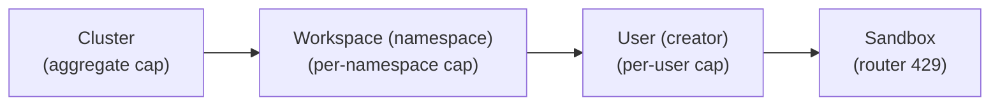

<!-- Copyright (c) Microsoft Corporation.
Licensed under the MIT License. -->

# Inference budgets

Bridge adds a **hierarchy** over inference token spend, above the per-sandbox
`InferencePolicy` the kars controller already compiles and the router already
enforces (429 per sandbox):



Configure it in **Operator Console → Policies → Inference budgets**.
All hierarchy changes (cluster, workspace, and user caps, including decreases
and clearing a rule) require **admin**. Under SSO, both the web request proxy and
the BFF enforce this from verified signed session roles. Operators can still
read budgets and manage the separate per-sandbox inference policies. The dev
role cookie and `BRIDGE_ROLES` cannot grant SSO admin access. See [RBAC](rbac.md).

## Enforcement modes

Finite `GovernedInference` Mission budgets also require operator-declared
model contracts. Package validation, saved-Mission validation, and both direct
creation-with-launch, saved-Mission launch and immediate replication reject an absent, unreadable,
malformed or invalid contract catalogue, or a requested primary/fallback model
without a current contract (including maximum prices for a currency cap).
Provider sign-in and model discovery do not enroll these contracts.

This preflight is a **necessary-condition check**, not enforcement proof:
finding a model name in the catalogue remains a warning, never a green
readiness assertion. The router separately verifies the exact provider,
endpoint, operation, account, broker, credentials and reservations.
Do not remove a Mission's cap to bypass a missing-contract failure.
Mission review, saved-Mission execution and Team preflight share the same
failure-first check display. Blocking reasons stay visible; warning and
passed-check disclosures retain every detail without burying the blocker.
Warnings are not execution proof and must still be reviewed.

Each level has one of three modes:

| Mode | Behavior |
|------|----------|
| **passive** | Never blocks. Raises an alert when over budget (the meter turns amber). |
| **buffer** | Allows up to `limit × (1 + bufferPercent/100)`, then blocks. An admin must raise it to proceed. |
| **strict** | Blocks at 100% of the limit. Only an admin can raise it. |

## How it's measured & enforced

- **Measured** daily (UTC) from completed run outputs — the same `totalTokens` the
  efficiency engine reads — aggregated per cluster and per namespace.
- **Enforced** by the Bridge at the point work is launched: `create_task` (on
  launch), `create_team` (on launch), and `run_mission` call
  `enforce_launch_budget(cluster, ns)`. A `strict`/over-buffer level returns
  `422` with an admin-raise message; `passive` always passes (and surfaces as an
  alert). The per-sandbox cap is separately enforced by the router.
- **Stored** in the `kars-inference-budgets` ConfigMap (`kars-system`), key
  `budgets.json`:
  ```json
  {
    "cluster": { "daily_tokens": 1000000, "mode": "buffer", "buffer_percent": 20 },
    "workspaces": {
      "kars-system": { "daily_tokens": 300000, "mode": "strict", "buffer_percent": 0 }
    }
  }
  ```

## Editing policies

`InferencePolicy.spec.tokenBudget` configures the router's per-request,
daily and monthly token limits. It is separate from a Mission's
`GovernedInference` lifetime budget and its model-contract requirements;
one must not be silently substituted for the other.

Controller-generated **per-sandbox** policies (`InferencePolicy` CRs) select a
Mission's model routes; they do not translate its lifetime cap into a daily
token limit. On the same page an operator can:

- **author** a standalone `InferencePolicy` (a selector + token budget +
  content-safety floor) — `PUT /api/operator/inferencepolicies`;
- **edit** a policy's daily budget in place — `PATCH …/inferencepolicies/{name}`;
- **remove** an authored one.

Rejected saves preserve the authored name, specification and explicit force
choice, so an operator can correct a validation error and retry without
re-entering the resource identity. Errors and successful saves are announced
to assistive technology.
Policy, MCP and profile editors open in viewport-sized native dialogs rather
than squeezing the form into a table cell. Keyboard focus stays in the dialog
and returns to its trigger on dismissal; Escape and Cancel preserve the draft
and cannot dismiss an in-flight save.

## API

| Method | Path |
|--------|------|
| GET | `/api/operator/inference-budgets` — hierarchy + live measured usage |
| PUT | `/api/operator/inference-budgets/cluster` — set/clear the cluster cap |
| PUT | `/api/operator/inference-budgets/workspaces/{ns}` — set/clear a workspace cap |
| PUT | `/api/operator/inference-budgets/users/{user}` — set/clear a user cap |

Utilization also surfaces on **Insights → Budget utilization** (live meters).
