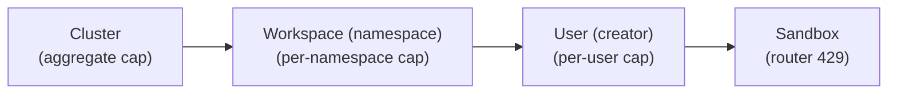

<!-- Copyright (c) Microsoft Corporation.
Licensed under the MIT License. -->

# Inference budgets

Bridge adds a **hierarchy** over inference token spend, above the per-sandbox
`InferencePolicy` the kars controller already compiles and the router already
enforces (429 per sandbox):



Configure it in **Operator Console → Policies → Inference budgets**.
All hierarchy changes (cluster, workspace, and user caps, including decreases
and clearing a rule) require **admin**. Under SSO, both the web request proxy and
the BFF enforce this from verified signed session roles. Operators can still
read budgets and manage the separate per-sandbox inference policies. The dev
role cookie and `BRIDGE_ROLES` cannot grant SSO admin access. See [RBAC](rbac.md).

## Inheriting controls when composing work

Administrators configure cluster, workspace (namespace) and account rules. Mission
and Team composition resolves the applicable rules on the server using the current
workspace and authenticated account; it does not expose other workspaces' rules.
A selected or proposed Ready profile also contributes its live envelope ceiling.
All applicable controls still apply: selecting a workspace is not permission to
weaken a cluster rule, and a reporting contact is not a spending-policy ancestor.

**Spending limits** in review are optional tighter limits. New proposals do not
turn estimated work or daily policy amounts into finite lifetime allocations.
Recomposition carries reviewed shared and named-role caps explicitly; missing
capped roles, invalid limits and malformed edited plans are rejected rather than
discarded. A profile can tighten the shared ceiling. Smaller requested monetary
limits remain intact. Switching runtimes does not increase a token limit.
Limits mentioned in natural-language requests must be confirmed in these fields;
estimates and prose do not change spending settings.

The compose and compose-team APIs require a `spending` object:
`{"budget_tokens":null,"role_tokens":{}}` requests inheritance without extra caps;
`{"budget_tokens":9000000,"role_tokens":{"reviewer":2000000}}` retains explicit
limits. Missing settings are rejected, not interpreted as permission to clear
limits. An outdated editor asks users to copy their draft safely before reloading.
Policy read/parse failures preserve the draft and give a spending-settings error,
not an instruction to reconnect the provider.

Preflight shows **Workspace spending rules**, including the applicable daily caps,
mode and completed usage today (UTC), and launch checks them again. This is not a
balance, an allocation, or a guarantee of capacity for concurrent in-flight work.
The existing lifetime broker separately authorizes funding, reserves requests and
settles actual usage. The daily usage collector is not an atomic reservation ledger.

## Mission accounting enrollment

New Missions reviewed in Bridge retain `GovernedInference` scope with either
finite or blank aggregate caps, in both package preflight and creation. Blank
caps mean no requested aggregate ceiling, not disabled accounting and not an
operator-authorized unlimited allowance. Funding, inherited ceilings, current
model contracts and runtime admission remain independently enforced. Legacy
unscoped requests remain unscoped; invalid finite limits are never discarded.

## Enforcement modes

Finite `GovernedInference` Mission budgets also require operator-declared
model contracts. Package validation, saved-Mission validation, and both direct
creation-with-launch, saved-Mission launch and immediate replication reject an absent, unreadable,
malformed or invalid contract catalogue, or a requested primary/fallback model
without a current contract (including maximum prices for a currency cap).
Provider sign-in and model discovery do not enroll these contracts.

This preflight is a **necessary-condition check**, not enforcement proof:
finding a model name in the catalogue remains a warning, never a green
readiness assertion. The router separately verifies the exact provider,
endpoint, operation, account, broker, credentials and reservations.
Do not remove a Mission's cap to bypass a missing-contract failure.
Mission review, saved-Mission execution and Team preflight share the same
failure-first check display. Blocking reasons stay visible; warning and
passed-check disclosures retain every detail without burying the blocker.
Warnings are not execution proof and must still be reviewed.

### Resolving a model-contract preflight failure

A model spending contract is administrator-reviewed configuration for an exact
provider identity, endpoint, model and operation. Its input/output bounds
(including reasoning tokens) let Kars reserve worst-case capacity before a
request; monetary ceilings additionally require maximum charges. It is not a
legal agreement, a provider connection, or a grant of tokens.

The shared failure display says **Spending setup needs attention** and explains
what to do next. **Review spending limits** focuses the shared token field in
Mission and Team setup. Each execution role also has a labeled token-limit field,
so changing a role limit does not require editing JSON. Role controls and the
advanced execution-plan editor use the same draft. Invalid role limits remain
visible and prevent readiness checks and submission instead of becoming unlimited.

**Copy support request** copies the check and requested limits for the user to
send to their administrator; it does not send anything automatically or include
the full work plan. If clipboard access is unavailable, a selectable text field
provides the same message. Exact backend details and enrollment instructions are
collapsed under **Technical details for your administrator**. The same help appears
if package creation reports a missing model contract before review; that message
retains the failed proposal's diagnostic without inventing limits for the current draft.

Mission and Team checks list the requested aggregate and execution-role limits
beside the failure. These are not account balances or a complete view of inherited
ceilings. An unbounded workspace allowance does not remove finite package or role
limits; clearing only an aggregate field leaves explicit role limits intact.
Blank role fields inherit the shared limit. Do not remove an intended cap to
bypass enforcement. Editing settings requires a fresh check before launch.

- **Package author:** use **Review spending limits** to review the shared token/cost
  fields, role limits and member/profile ceilings. If these limits look right—or
  you are unsure—use **Copy support request** and send it to your Kars administrator.
- **Cluster administrator:** review provider-supported bounds and enroll the
  exact route through Core Helm `inferenceBudget.contracts`, with current
  validity and a new `inferenceBudget.catalogVersion`. Preserve existing
  contracts and funding; never infer bounds or prices from another model. Follow
  [the operator contract guide](../../docs/governed-inference-budgets.md#renewing-reviewed-model-contracts).
  There is no browser contract editor today. Daily budget controls on the
  Policies page configure a different mechanism and cannot enroll model contracts.
- Validate again after correction. Preflight neither launches the workload nor
  proves its runtime behavior. Intentionally unbounded packages without effective
  token or monetary ceilings need no model spending contract; accounting,
  funding authorization, provider limits and security checks still apply.

Each level has one of three modes:

| Mode | Behavior |
|------|----------|
| **passive** | Never blocks. Raises an alert when over budget (the meter turns amber). |
| **buffer** | Allows up to `limit × (1 + bufferPercent/100)`, then blocks. An admin must raise it to proceed. |
| **strict** | Blocks at 100% of the limit. Only an admin can raise it. |

## How it's measured & enforced

- **Measured** daily (UTC) from completed run outputs — the same `totalTokens` the
  efficiency engine reads — aggregated per cluster and per namespace.
- **Enforced** by the Bridge at the point work is launched: `create_task` (on
  launch), `create_team` (on launch), and `run_mission` call
  `enforce_launch_budget(cluster, ns, user)`. Stored Mission validation and launch
  use its recorded creator; draft validation uses the authenticated creator. A `strict`/over-buffer level returns
  `422` with an admin-raise message; `passive` always passes (and surfaces as an
  alert). The per-sandbox cap is separately enforced by the router.
- **Stored** in the `kars-inference-budgets` ConfigMap (`kars-system`), key
  `budgets.json`:
  ```json
  {
    "cluster": { "daily_tokens": 1000000, "mode": "buffer", "buffer_percent": 20 },
    "workspaces": {
      "kars-system": { "daily_tokens": 300000, "mode": "strict", "buffer_percent": 0 }
    }
  }
  ```

## Team lifetime budget status

Team detail shows the effective lifetime token and monetary ceilings separately
from settled usage, reservations and uncertain charges. The original envelope
remains available as historical evidence, not as the effective ceiling.
Only a validated account-bound unbounded token receipt is labeled **Unlimited ·
non-expiring token allowance**; an absent/default token cap does not imply that
allowance. Monetary limits and all other admission controls remain independent.

The existing owner-authorized `GET /api/namespaces/{ns}/teams/{name}` includes
`budget_status`. The controller extends its existing authenticated Team accounting
reader with `status.inferenceBudgetObservation`: effective limits, allowance kind,
account phase and meters from the verified pinned ledger. The BFF consumes only
this protected Team status, after the existing workspace/Team-owner checks. It
checks the Team/account pin, original grant, generation, usage consistency and
observation age (at most five minutes, never future-dated). Exact amounts are
decimal strings to avoid browser integer rounding. This is an observed snapshot,
not live dispatch-readiness proof or an invoice. No raw account, node authority or
operator controls reach the browser.

Deploy the updated controller and KarsTeam CRD schema with BFF/web; an older
controller or schema cannot supply this observation. Missing bindings, failed
controller reads and missing, stale or invalid observations display
**unavailable**, never zero usage. Failed/degraded observations are cleared.
Default Bridge RBAC remains sufficient: ordinary newly created and existing Teams
need no per-account registration, delegation, or extra account read permissions.
The separate orchestrator-only exact-account delegation is unchanged; it is not
a Team registration mechanism. No list/watch or broad account access is added.

## Editing policies

`InferencePolicy.spec.tokenBudget` configures the router's per-request,
daily and monthly token limits. It is separate from a Mission's
`GovernedInference` lifetime budget and its model-contract requirements;
one must not be silently substituted for the other.

Controller-generated **per-sandbox** policies (`InferencePolicy` CRs) select a
Mission's model routes; they do not translate its lifetime cap into a daily
token limit. On the same page an operator can:

- **author** a standalone `InferencePolicy` (a selector + token budget +
  content-safety floor) — `PUT /api/operator/inferencepolicies`;
- **edit** a policy's daily budget in place — `PATCH …/inferencepolicies/{name}`;
- **remove** an authored one.

Rejected saves preserve the authored name, specification and explicit force
choice, so an operator can correct a validation error and retry without
re-entering the resource identity. Errors and successful saves are announced
to assistive technology.
Policy, MCP and profile editors open in viewport-sized native dialogs rather
than squeezing the form into a table cell. Keyboard focus stays in the dialog
and returns to its trigger on dismissal; Escape and Cancel preserve the draft
and cannot dismiss an in-flight save.

## API

| Method | Path |
|--------|------|
| GET | `/api/operator/inference-budgets` — hierarchy + live measured usage |
| PUT | `/api/operator/inference-budgets/cluster` — set/clear the cluster cap |
| PUT | `/api/operator/inference-budgets/workspaces/{ns}` — set/clear a workspace cap |
| PUT | `/api/operator/inference-budgets/users/{user}` — set/clear a user cap |

Utilization also surfaces on **Insights → Budget utilization** (live meters).
