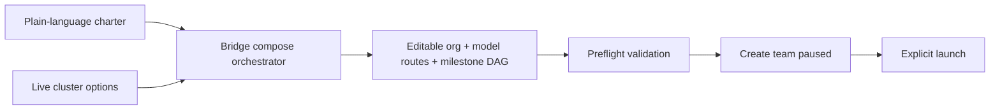
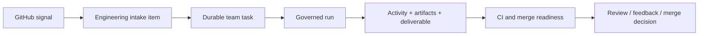
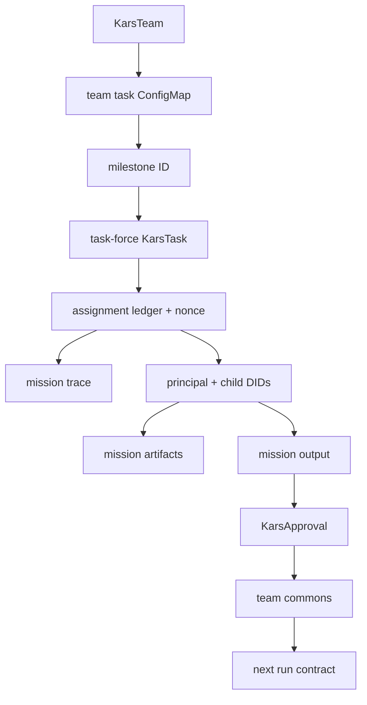

<!-- Copyright (c) Microsoft Corporation.
Licensed under the MIT License. -->

# Team workflows: from intent to reviewed outcome

This guide ties together the Bridge concepts that appear across the Workspace:
teams, engineering intake, work queue, runs, activity, artifacts, deliverables,
approvals, outcomes, and memory.

Bridge presents these states; Kars owns and persists them. This page describes
the product contract. The monorepo integration candidate has not yet qualified
the complete controller/runtime journey; see [Compatibility](compatibility.md).
In particular, importing the UI does not provide missing governed task delivery,
authenticated runtime transport, or restart-recovery behavior in an older core.

## The short version

```text
Intent
  -> proposed org + milestone graph
  -> human review + preflight
  -> standing team
  -> one eligible milestone
  -> one governed run
  -> principal + selected specialists
  -> activity, artifacts, and structured handbacks
  -> principal deliverable + truthfulness gate
  -> optional human review
  -> approved team memory + next milestone
```

## Authoring reusable building blocks

The console's Team profile, inference-policy and custom MCP editors carry the
current draft between visual and JSON modes. Invalid JSON stays editable without
discarding it. Settings that the visual fields cannot preserve, including nested
authority extensions and signed bundles, stay in JSON mode with an explanation.
Managed MCP presets remain JSON-only. Saving a profile or registering an MCP
server does not itself authorize a Team launch or tool call.

## Current execution boundary

A reviewed `kars.execution-plan/v1` is retained in Task and Team blueprints,
including role overrides, replication, authority digests and signed launch
packages. Bridge compares the API's captured plan with the reviewed plan before
continuing creation or plan updates. An older CRD that prunes the plan must fail
this check; saving a name or objective is not equivalent to saving the plan.

During proposal parsing, role configuration is matched by exact name (after
trimming surrounding whitespace), never by roster position. Reordering proposed
roles preserves each named role's prompt, runtime, model and skills. A planned
role without a matching roster entry starts with its own objective and no
role-specific overrides; subsequent route qualification still applies. A blank
matched prompt also uses that role's planned objective.

Bridge pins the Team's resolved ToolPolicy onto each explicit runtime/model
roster blueprint during creation and roster edits. The controller treats such
blueprints as complete overrides, not partial merges. A role without an override
keeps normal inheritance; this binding does not add egress or copy the Team's
execution plan into a member.

Route qualification uses each exact-name role's reviewed `budget_tokens`, not
another role's allowance. Team create/update checks use the smaller of the role
cap and Team lifetime cap when both are present; without a role cap, they
retain the lifetime-cap check. Compose has no total-budget field, so it uses the
explicit role cap or preserves unspecified-budget qualification when absent.
Candidate normalization, fallback routes and qualification diagnostics use the
same bound without changing reviewed caps. This is route qualification, not
runtime reservation or enforcement; execution must also pass the gates below.

**The current source implements restricted reviewed filesystem execution**, not
general-purpose execution of every proposed plan. The existing controller and
encrypted dispatcher schedule role dependencies, reserve governed role budgets,
run fresh-context phase children, retain immutable `handoff.md` inputs, and
synthesize the result in the root Task. Both OpenClaw and Hermes use this path.
If a revision-bound phase fails before synthesis, the run is shown as failed,
with its retained error and phase timestamp, even when no principal result or
assignment exists. Completed role evidence remains available; it is not a
successful final delivery.
An explicit operator stop before root output returns that exact active work item
to the queue while keeping the Team paused. Its history records a cancellation
with the real stop time and reason, not a fabricated result or output digest.
Resume and a new run request are required to execute it again.
Active plans require exactly filesystem-read/write capabilities, no required
external-tool calls, a positive tool-call ceiling, and UTF-8 text, Markdown or
JSON deliverables. Unsupported plans remain inactive and reject activation with
`TypedPlanExecutionUnavailable`; saving a plan does not authorize its execution.

A reviewed one-shot Task needs **delegation depth 2** (Task → role → phase).
A standing Team defaults to **depth 3** (Team → run → role → phase). Home selects
the reviewed Task depth; the API preserves explicitly reviewed caps, including
smaller draft caps. Launch, resume and manual run reject insufficient root or
effective member depth with `ReviewedDelegationDepthInsufficient`: re-review the
envelope rather than silently widening authority. Explicit member blueprints and
envelopes override inheritance. Draft saving, stopping a Task and purely pausing
a Team remain available.

A decomposition marker without its plan, or an unsupported marker, rejects with
`ReviewedExecutionPlanMissing`. A missing plan is not a legacy fallback when a
marker declares one. Unmarked legacy planless execution remains supported.
These are current-source/local integration claims. Fresh Helm installation and
complete customer-journey acceptance on Kind and AKS remain release gates.

The OpenClaw measured loop and encrypted mission protocol support a tested
**single-phase filesystem contract**. Version 2 requires a canonical phase and
its SHA256 digest in readiness, assignment and replies; version 1 cannot silently
drop constraints. Only explicitly granted `filesystem-read`/`filesystem-write`
tools are exposed, actual calls are checked again, and router policy authorization
is still required. `maxToolCalls` limits attempted calls (including denied,
malformed and failed calls); an overflowing batch fails before any tool runs.
`minToolCalls` counts only successful authorized filesystem operations.

The local version-3 contract additionally supports bounded **immutable input
artifacts**. Its canonical SHA256 digest binds the exact UTF-8 bytes, input aliases
and upstream Task/run/assignment/producer identities. Only encrypted assignments
carry input bytes; readiness probes, installed contracts and replies carry the
digest, not those bytes. The receiver checks its independently installed digest
before authorization or reserving execution, and exact replay returns the cached
reply rather than executing again.

An admitted downstream execution reads these snapshots through the existing
`file_read` tool at `/sandbox/.kars-inputs/<alias>`. The namespace is read-only and
execution-local: unknown inputs or path aliases cannot fall through to disk, and
another execution cannot access a previous snapshot. Model instructions contain
only the input manifest, not the upstream document text as system instructions.
The reviewed read capability, attempted-call ceiling and router authorization
still apply. Inputs are never automatically exported; useful downstream output
must be explicitly captured as a separately named artifact. Failed execution
exports no artifacts.

The retained-result reader accepts **content-free references**, not caller-provided
bytes. It checks the live source Task UID, the owned successful text-v1 attempt,
the exact assignment and producer, and both canonical immutable result ConfigMaps
using the same decoder and projection builder as publication. It verifies the
named document's hash, snapshots the bytes and rechecks every resource before
returning. Synthetic `response.md` and router-observation system evidence cannot
be selected as useful input documents. A source Task may have moved to a later
run: this reads retained evidence, not the current deliverable or its approval.

Bridge's terminal-evidence reader accepts validated version-1 through version-4
replies. It checks the canonical filesystem phase digest, supported capabilities,
attempted/successful call bounds and digest-only input contract, then applies the
existing Task UID, run, assignment, producer and exact-usage checks. Version 4
also requires bounded, unique output names and matching text-v1 artifacts on
success; its input digest is optional. Artifact envelopes retain the shared
filename, content, count and serialized-size limits. Multiple required names
are sorted without mutating the producer's immutable snapshot.

Valid newer replies feed the same revision-bound Activity reader; provisional
live Activity also binds required output names to its candidate and assignment.
These checks do not add a second recorder, a live fallback or permission to
execute a plan. Shared JSON fixtures are checked by both the TypeScript wire
parser and the Rust reader, including defaults, capability ordering, Unicode
canonicalization and version-4 contracts with and without immutable inputs.

The retained-input reader alone does not authorize a dependency or review
decision. For reviewed execution, the controller persists `kars.reviewed-run/v1`
state binding the root UID, generation, authorization digest, run nonce, objective,
plan digest and reserved role/phase children. The dispatcher independently
reconstructs that authority, validates attenuated child specs and exact upstream
handoffs, and rechecks the resources before execution and completion. Reverse
reads are not a cross-resource transaction. Reviewed workloads receive a version-4
contract binding the phase, immutable inputs and required output names; ordinary
planless workloads retain version 1. The Bridge reader's version-4 compatibility
is locally qualified. This does not prove retained file bytes, installed runtime
behavior or a complete reviewed Team journey; those remain deployment acceptance
gates.

Role and synthesis budgets must also fit the installed inference contract. The
existing ledger reserves the contract's attested maximum input plus the requested
output, not an estimate from prompt length. For example, an input bound of
272,000 tokens requires at least 272,001 tokens even with a one-token output
limit; proposed role caps of 80,000 or 120,000 cannot admit that request. Lowering
the output limit alone does not fix that mismatch. Reviewed allocation must leave
room for synthesis and remain within the finite Team lifetime budget; neither
input attestations nor approved caps may be silently weakened or increased.

The receiver captures its target and installed contract once at startup. Only an
exact contract match can answer readiness or reserve a run; incoming assignments
cannot select or downgrade that contract. OpenClaw bootstrap captures
`KARS_MISSION_CONTRACT` together with the Secret-backed identity and workload
binding before awaiting exclusive prekey-writer custody. Absent configuration
selects legacy version 1; present configuration must be a valid JSON contract of
at most 8 KiB (exact version/phase/digest fields), or initialization fails closed
without releasing custody for an unsafe retry. The receiver passes its own
immutable phase to execution, not the peer's copy. Startup capture pins local
configuration; reviewed Task/role/run/phase authority comes from the independent
controller and dispatcher checks above. The controller explicitly projects the
reviewed contract when a valid grant exists, otherwise legacy version 1,
overriding any `envFrom` credentials value. A caller-supplied phase is not authority.

Legacy execution also requires a controller-installed `KARS_MISSION_ADMISSION`,
captured with the bootstrap binding before the first await. Its strict, bounded
JSON contains the Task generation and full authorization digest plus either an
idle state or an exact run nonce and objective digest. Idle runtimes accept no
mission probes or assignments. Run runtimes reject a different nonce or assignment
objective before readiness, policy authorization, ledger reservation or execution.
The authorization digest covers effective Task instructions (including its
trimmed objective); the separate objective digest covers the exact untrimmed UTF8
execution bytes, including run-bound revision objectives.

Before new dispatch, the store requires current Task readiness, observed generation
and authorization digest, then checks the controller binding against the actual
Deployment's explicit admission and independently reconstructed contract. Workload ownership,
incarnation and reverse-read freshness checks remain mandatory. The controller
watches annotation-only Task requests to refresh the installed admission;
acknowledgment and completion alone do not change the pod template. Already-recorded
terminal evidence can still be recovered and published without requiring a
replacement runtime or resending its assignment. These bounded checks and startup
capture are **not an online lease or atomic revocation**. Reviewed scheduling adds
the authority checks above without bypassing activation guards. Controller,
dispatcher and runtime updates must be coordinated: new dispatch rejects missing
admission, and an enabled runtime with missing admission fails initialization.

Filesystem operations use the packaged Python standard-library helper at
`dist/core/task-filesystem.py` (requires `/usr/bin/python3`, already in the sandbox
base). The helper runs without a shell, site packages or inherited environment,
with bounded input/output and a 10-second timeout. Both tools resolve paths under
`/sandbox/` or `/tmp/`, then open each untrusted parent relative to a held directory
descriptor without following symlinks. Administrator-owned roots may be platform
aliases, such as macOS `/tmp`. Open descriptors pin directory/file identity across
path swaps; this is not a snapshot or a prohibition on concurrent inode renames.
Reads accept regular files only, do not block on FIFOs, loop over short reads and
report actual bytes and incomplete reads. Writes are capped at 16 MiB and replace
a directory entry atomically with a new mode-0600 inode, rather than truncating an
existing hard-linked inode. Existing symlinks/special files are refused; a symlink
raced in before replacement is replaced, never followed. Successful writes do
not preserve prior inode identity, permissions or hard links. Failed operations
are not counted as success and do not commit or export artifacts. A helper timeout is a
failure, not proof that no filesystem effect occurred. These tools do not isolate
all same-UID processes or replace sandbox OS permissions and mount boundaries.

The runtime reports copied accounting after each response, batch reservation and
attempted call. The receiver and durable journal reject changed contracts,
regressing counters and erased evidence. Unknown usage cannot become known after
consumption. Failures retain validated counters but export no artifacts; an
unmeasured failure reports unknown usage. Bounded immutable replies and cached
terminal replay preserve the journal limit without re-executing tools. Tests
exercise real HTTP/filesystem execution through the receiver at 25 model rounds
and 32 tool attempts, including failure and exact replay.

These are library/runtime and in-process durability proofs, **not live Team
acceptance**. The dispatcher admits only the reviewed subset with matching
installed authority; unsupported capabilities, required external-tool contracts
and unsolicited phases fail before inference. Previously claimed terminal
attempts remain recoverable without resend. The root's remaining governed budget
bounds synthesis; role allocations cannot manufacture additional authority or
replenish the Team's lifetime allowance.

The roster alone is not proof that specialists performed work. The current
source connects manual and cadence admission to UID-owned backlog claiming,
dependency selection, checkpoint review and revision history. Installed
queue-to-review acceptance is still required; the source change is not a claim
that the complete journey has passed.

### Work ownership and review

New backlog ConfigMaps have an exclusive controller owner reference to the
current Team UID. Missing stores start empty; malformed JSON, missing payloads,
foreign ownership and replacement UIDs fail closed rather than becoming empty
queues. Writes use resource-version compare-and-swap and preserve other data.
Existing name-only stores are **not implicitly adopted**. An operator must verify
the live Team and store identities and payload, retain that evidence, then add
the exact owner reference with UID/resource-version preconditions. Migration
does not assign an earlier run to pending work or invent completed history.

An eligible item is claimed by the staged Task UID and run nonce before the
existing admission reservation activates it. The request binds its title,
details, dependencies, criteria and revision feedback. Assigned work and recorded
attempts cannot be removed through the backlog API. Missing output or a stopped
run is not success and does not automatically authorize replay.

Successful work without a requested review can complete automatically. With
**Require human review** selected, it remains awaiting review and contributes no
commons entry until its exact checkpoint is approved. Execution retires before
the checkpoint is created, avoiding a race with the Task's generation change.
The browser submits the displayed Task UID and nonce; an older page cannot
approve a newer run. A recorded decision stays disabled after refresh while
the controller processes it.

Written change requests retain the previous attempt and its output hash, return
the item to the pending queue, and bind feedback into a fresh Task/run. Approval
completes the item and makes its dependents eligible. This reuses the same Team
lifetime account; neither revisions nor later intake replenish its budget.

Engineering intake uses this same owned queue and canonical UID/resource-version
fenced run admission; it does not write a separate run trigger or rewrite a claimed
request. Changed source facts create distinct dependent work while preserving prior
assignments and completed history. Repeating the same source observation or human
PR feedback does not replay a completed item.

An unassigned source withdrawal is recorded as `retired`, with its actual observation
timestamp and no fabricated run binding. The UI calls this **Source retired**, not
an executed or approved result. It releases queue dependencies but creates no output,
approval or commons evidence.

## Reviewed Team lifetime budget

New Teams created in Bridge require an explicitly reviewed positive whole-number
**token limit** with `GovernedInference` scope. There is no preselected cap.
The same Team-UID lifetime account bounds the principal, members and every run,
including later intake; starting another run does not replenish the allowance.
Changing the cap invalidates the composer's previous pre-flight result.
Pre-flight and model-route qualification check the proposed envelope, not whether
its eventual live budget account, broker or provider reservation is ready.

The API retains compatibility with omitted/null budgets for legacy callers; this
is not governed budget enrollment. When a budget is supplied, it must have
explicit `GovernedInference` scope and at least one positive safe whole-number
limit (tokens and/or micro-USD). Empty, zero, negative, fractional and unsafe
limits are rejected, not silently removed. Principal, specialist and fallback
route qualification uses the reviewed token limit. Route edits use the stored
limit and cannot increase it. Team detail shows the configured limit and scope,
not a guessed remaining balance. A changed lifetime limit requires a separately
reviewed new Team, not editing or removing an existing Team's cap. Team update
requests that explicitly include `budget`, even `null`, are rejected; unrelated
route or lifecycle edits keep the stored lifetime limit.

Creation remains paused by default. The UI's opt-in launch sequence creates the
Team paused, installs its queue and engineering settings, then requests resume;
that sequence does not bypass the typed-plan activation guard above. Until a
plan-aware executor is available, retain the Team as a reviewed paused draft.
This budget contract alone is not proof of useful Team delivery or beta readiness.

## What each Workspace concept means

| Workspace concept | What it is | What it is not |
|---|---|---|
| Team | A persistent charter, org chart, authority envelope, backlog, memory identity, and explicit runtime lifecycle policy. | A single run or an implicitly permanent pod. |
| Work queue | Durable milestones/tasks the team will execute. | A live event stream. |
| Run | One attempt to execute one milestone or charter tick. | The whole lifetime of the team. |
| Execution flow / activity | The chronological signal inside one run. | A separate work item. |
| Agent | A principal or specialist worker selected for the run. | The durable team itself. |
| Artifact | A file produced by an individual agent or the principal. | The final outcome classification. |
| Deliverable | The principal's final synthesis for the run. | Every raw agent file. |
| Outcome | Delivered, delivered with issues, no action, incomplete, or failed. | A model's self-reported confidence. |
| Approval | A typed human decision that changes workflow state. | Free-form feedback with no controller effect. |
| Memory | Approved retained knowledge injected into later runs. | A replay of every raw conversation. |
| Engineering intake | Repository signal discovery and backlog creation. | The activity timeline or the agents doing the work. |

### Current artifacts versus retained evidence

The mission artifact download endpoint serves only the current committed run of
a live Task in `kars-system`. Its Task UID, requested/completed run nonce and
artifact ownership must match. A missing, recreated or superseded Task does not
make an old file current. Downloads require an explicit `run_nonce` query
parameter; omitted revisions return 400, superseded or incomplete revisions 409,
and missing or inaccessible records 404. Ownership and revision are rechecked
after reading evidence and before serving bytes. Retained historical evidence is
a separate capability; this endpoint does not establish artifact access after
Task deletion.

### Revision-bound mission evidence

Mission detail and list results join the live Task UID with its exact requested
and completed revision, not a name-only retained output. A changed or deleted
Task during a detail read withholds that response. Feedback requests a distinct
revision; it does not prove the next execution has started.

For durable agent results, the recorded producer includes agent DID, assignment,
Task UID, sandbox/pod/boot identity, and timestamps. Current registry identity is
not evidence of who produced an earlier result. Whole-run usage comes from a
validated terminal record; cumulative progress snapshots are never added together.
Missing usage or activity is unavailable, not zero. Revision-pinned activity
streams close when the revision changes and only signal completion from a
matching terminal result, never merely because an artifact exists. If detailed
trace records are unavailable, Activity says so instead of showing a zero-work
graph or asking you to launch an already completed run. Available assignment and
approval records remain visible, without claiming a complete timeline. Produced
and review-history timestamps use explicitly labelled UTC for consistent display
across server rendering and browser timezones.

Approval requires an eligible useful successful result in the current revision.
Invalid terminal evidence cannot authorize a review mutation. Task-level receipts
without revision binding are explicitly labelled as such. Budget/failure messages
are reported observations, not independent accounting, proof of a root cause,
or a promise of reset or automatic recovery.

### Explicit text attachments on mission success

The bounded mission dispatcher advertises `artifactFormat: "text-v1"`. With a
compatible OpenClaw runtime, an authorized `file_write` can supply `artifact_name`
to attach the exact UTF-8 content it successfully wrote. The final answer remains
`response.md`; a path or an “artifact ready” message is not the document itself.
When attachment support is absent, the agent must return the complete answer
inline instead.

Attachments use flat filenames (letters/digits first, then letters, digits,
periods, underscores or hyphens; at most 128 characters). `response.md`,
`__proto__`, `constructor` and `prototype` are reserved. There may be at most
16 additional files, totaling 128 KiB of serialized JSON including UTF-8 text,
escaping and filenames. The entire encrypted mission payload remains bounded by
192 KiB, including final answer and evidence; exceeding it fails the mission.

A null or omitted `artifact_name` is local-only scratch. Nothing scans the
filesystem, reads older files, or implicitly exports output from another tool.
The last successful explicitly attached write to a name wins; later local-only
or failed writes do not replace it. Staged attachments are execution-local and
publish only with a successful terminal result, never on failure or in a later
revision. Named files share the current-run ownership and download fences above.
Transport success and valid files still require review for useful content.

### Engineering intake identity and existing PRs

Dependabot remediation work uses a versioned identity containing the repository,
the exact case-sensitive manifest path, and package name. For example,
`Services/package-lock.json` and `services/package-lock.json` are different
targets. Missing manifest metadata is also different from a file named
`unknown`. Repository casing does not create duplicate work.

Existing work IDs, runs, receipts, dependencies and history are not renamed.
Intake reuses an older remediation ID only when its retained structured source
metadata proves the same repository, manifest and package. If that evidence is
missing or ambiguous, the old history remains intact, the new versioned work is
tracked separately, and intake reports the ambiguity for review.

Open alerts for one target are aggregated by alert number, independent of poll
order. Comparison uses structured advisory and dependency facts, not titles,
candidate PR links, or poll timestamps. Unassigned pending work is refreshed in
place. Once a run or assignment nonce exists, its approved input is immutable:
new findings become a separate follow-up backlog task, dependent on unfinished
prior work. Completed task IDs, runs and PR evidence stay intact. Findings already
represented in retained work do not endlessly reopen on unchanged polls.

Only a complete successful open-alert scan can remove absent findings from
unassigned work. Empty pending work is labelled a source-only retirement, not a
delivered fix. Truncated scans retain unresolved pending findings; a later complete
scan determines withdrawals. Follow-ups include only newly observed source facts
and links to prior backlog/run evidence.

A PR title mentioning the package or advisory is only a search hint. It does
not prove that the PR fixes this manifest, does not mark remediation delivered,
and does not suppress new work. The assigned agent must inspect the actual diff
and current head-SHA evidence, reusing a matching PR rather than creating a
duplicate. Distinct manifest fixes must not be closed as duplicates.

## 1. Compose a team

From **Workspace -> Teams -> Set up a team**, enter a standing charter. The
Bridge composer reads the live cluster palette and proposes:

- a principal/default model;
- 2-4 focused evidence roles;
- per-role harness and model overrides;
- MCP services, egress mode, and public hosts;
- autonomy tier and cadence;
- runtime lifecycle and warm-idle policy;
- engineering intake settings for repository maintenance;
- a 2-8 milestone DAG for finite work.

The proposal is editable. It is not execution.



If the model response is malformed, Bridge performs one bounded repair. It does
not present generic fallback roles as a successful AI recommendation.

### Runtime lifecycle modes

Lifecycle mode controls runtime retention, not workflow durability. The charter,
queue, approvals, receipts, and approved memory remain durable in every mode.

| Mode | Runtime behavior | Use when |
|---|---|---|
| **Resource optimized** | Reuses the same principal while warm, then suspends it after the configured idle window. New work resumes the same team identity. | Default for most standing teams. |
| **Persistent** | Keeps the principal runtime ready until an operator explicitly pauses the team. | Low-latency work justifies continuous resource use. |
| **Ephemeral** | Creates a clean isolated runtime for each assignment and tears it down after evidence is retained. | Maximum isolation or compatibility with earlier teams. |

The controller never auto-suspends a runtime while an assignment is active or a
milestone is awaiting review. Pausing a team explicitly suspends retained
runtimes in all modes.

## 2. Understand the milestone graph

Each milestone contains:

- stable ID;
- title and description;
- preferred owner role;
- dependencies;
- acceptance criteria;
- optional review gate.

The dependency contract allows only a milestone whose dependencies are
`done` to run; `active` or `awaiting_review` work must block dependent assignments.
Admission and review continuation use the UID-bound work lifecycle described
above. Do not interpret queued milestones or a successful queue write as agent
activity; inspect the claimed run and its retained result.

## 3. Launch and watch a run

**Run now** records a one-shot request, not proof that an agent started or
produced a deliverable. The BFF checks the current owner and Team UID, rejects
paused Teams, pending requests and exact-owned active task forces, and writes
with UID/resourceVersion preconditions. Active-run checks cover the entire
namespace; labels alone neither establish ownership nor hide a running Task.
Concurrent Team changes return a conflict instead of overwriting newer intent.

Generated run IDs reserve room for the sandbox namespace prefix and preserve
the full run nonce. Long Team names use a bounded, name-hashed prefix; retained
older run names remain readable. Live history uses exact Team UID ownership
and the taskforce role rather than a name-prefix guess.

Retained runs are ordered by their Kubernetes creation time, not their opaque
identifiers. The latest-run link and live refresh follow that order. A local
**Run now** request keeps refreshing until its new run is observed, then releases
the request indicator so a later completed run does not require a page reload
before another request. Resuming also refreshes the controller's stale
hibernating state; an enabled but not-yet-active Team is not presented as paused.

The controller carries the Team's user-owner annotation into generated Tasks
and through reviewed role/phase parents. It repairs missing attribution only
under exact parent UID/controller custody, without replacing Tasks, reservations
or budget accounts. Conflicting existing attribution is rejected, never
overwritten; BFF ownership checks are unchanged.

The manual admission protocol separates durable stages:

1. Stage an exact-owned, **unlaunched** Task under a stable request identity.
2. Persist its Task UID, authority/spec digests and admission sequence in
   `status.runAdmission`, counting the reservation once.
3. Recheck current authority, finite shared budget and capacity; activate that
   exact Task with UID/resourceVersion preconditions.
4. Acknowledge only the matching request. A retry after a lost acknowledgement
   reuses the reservation rather than creating or relaunching work.

The latest admission remains after acknowledgement. Requests use canonical
`manual-<sequence>-<sha256>` identities; a later request advances the sequence
and creates a distinct Task under the same Team budget root, without resetting
settled spend. Missing, replaced or altered reserved Tasks fail closed rather
than being recreated. Credential drift still pauses the runtime promptly; only
its final credential-spec rewrite waits for a pending acknowledgement so the
original admission spec can be verified before rebinding.

Legacy timestamp-only `run-now` annotations are not silently converted or
executed. They remain rejected/pending. An operator must inspect the Team and
retained Task evidence before clearing an obsolete request with current UID/RV
preconditions and submitting a new reviewed request. Do not clear the retained
admission watermark, replay an old sequence, or treat a retry as permission to
reset the budget.

These are bounded cross-object checks, not a distributed transaction or lease.
A request, reservation, acknowledgement, Ready pod or generated-task count is
not delivery evidence. Engineering backlog assignment and checkpoint/revision
continuation additionally require their own matching work-ledger and retained
result evidence; an admission acknowledgement alone does not establish them.

The run page has four views:

1. **Overview:** role selection and durable handback state.
2. **Execution flow:** searchable lifecycle, tool calls, reasoning cost, and
   truthfulness decision.
3. **Deliverables:** principal output plus retained role artifacts.
4. **Research & egress:** network attempts, remote HTTP results, and actual
   network denials.

The signal path summarizes the expected order:

```text
controller assignment -> principal -> specialists -> tools -> handbacks -> truthfulness gate
```

An in-flight page never calls work "verified." Verification appears only after
the terminal evidence gate.

## 4. Activity, artifacts, and deliverable

These answer different questions:

- **Activity:** What happened, in what order, and where did it fail?
- **Artifacts:** What files did each agent produce?
- **Deliverable:** What did the principal conclude after reviewing handbacks?

Examples:

| Evidence | Typical location |
|---|---|
| Model round and tool result | Execution flow |
| `application-engineer` report | Role artifact |
| `task-checkpoint.json` | Deliverables and checkpoint panel |
| Principal readiness report | Deliverable |
| Missing handback | Role delivery and truthfulness failure |

### Live graph and retained observations

The execution graph stays visible while waiting for revision-bound records. On
runtimes that negotiate `router-observations-v1`, correlated model responses
update the graph and default recorded timeline through encrypted assignment progress. The latest snapshot is
retained in the attempt's running reply, not copied into every journal entry.
The Bridge validates the owned Task, run nonce, assignment, producer, and attempt
before streaming that snapshot. A different revision or revoked binding clears
the live selection; it must not fall back to another pod's telemetry.

Live observations are **provisional**: they do not establish completion, useful
delivery, approval, or a downloadable artifact. Completed revisions may separately
retain `kars-router-observations.json` with their deliverables. The graph, timeline,
and Tools view use that revision's exact producer and observation IDs, not the current
roster or an inferred filename. Selecting the producer follows that exact producer's
cumulative records; selecting an action or folded group keeps only those exact
observations selected. Rounds & tools nests proposals and results under their
original proposing round, while results also identify the reporting round. A
tool-only selection does not import an unselected round's evidence. Router timeline
rows replace legacy model/tool rows
when a bound snapshot is available, while assignment and approval records remain.
Timestamped records are ordered separately from router sequence numbers; no
cross-source chronology or missing timestamps are invented. New revisions reset
timeline search, and revoked live bindings remove provisional observations.
Older runtimes without negotiated progress retain
their existing behavior; absence of records does not establish absence of work.

A **model-proposed** tool is not an executed tool. A **harness-reported** result is
shown only after the router observes it in a subsequent model request; an unknown
outcome is not success. Router round IDs are displayed unchanged. Raw records do
not contain timestamps, tool arguments, result contents, or destinations, so the
graph does not invent them. Missing rounds, truncated coverage, unavailable usage,
and unavailable outcomes remain explicit when inspecting records.

Internal evidence files such as `collaboration.jsonl` and
`subagent-telemetry.jsonl` remain durable even after child sandboxes are gone.

Role artifact attribution is **recorded** only when explicit producer metadata
matches the role. An explicit different producer wins over a role-looking filename
or path. Files without producer metadata may be grouped using **inferred**
attribution, which is labelled per file; unmatched producers remain visible
without claiming a roster role. Neither recorded nor inferred artifact ownership
proves a structured handback or overrides run nonces and partial-persistence status.

## 5. Checkpoint and restart

Every milestone receives a controller-owned, nonce-scoped checkpoint before
task delivery. The run page shows it as **Durable milestone checkpoint**.

If the principal pod restarts, the controller:

1. discovers the new worker identity;
2. preserves the same task nonce;
3. rereads the checkpoint;
4. reroutes the verified contract;
5. records **Worker restarted; assignment rerouted** in Execution flow.

The replacement does not consume a checkpoint from an older run.

## 6. Review and request changes

When a review-required milestone delivers, its work-queue state becomes
**Awaiting review**.

- **Approve milestone:** the milestone becomes `done`, dependent work unlocks,
  and the approved output is promoted to team memory.
- **Request changes:** feedback is required, appended with the source run, and
  the milestone returns to `pending`.

The source run remains immutable evidence in both cases.

Approval is a typed `KarsApproval`; Bridge is not required for Kars to resolve
the decision.

## 7. Memory continuity

Runtime lifetime depends on the selected lifecycle mode. Team continuity never
depends on pod lifetime; it is persisted through:

- its `KarsTeam` charter and roster;
- its durable work queue;
- approved entries in team commons.

The team page displays the count of **carried-forward memories**. Later runs
receive recent approved entries in an untrusted reference-data frame. Memory
may inform work, but it cannot override the current charter or contract.

Review-required output is not promoted before approval.

## 8. Engineering intake

Engineering intake continuously observes configured repository signals such as
Dependabot PRs, vulnerability alerts, code scanning, and secret scanning.

It belongs before the work queue:



The intake item links to the exact run that handled it. Opening the run shows
the activity and agents; opening its deliverables shows what they produced.

## 9. Egress decisions

The UI separates two failure classes:

- **Network denied:** the sandbox boundary blocked an unapproved host. This is
  eligible for an `EgressApproval`.
- **Remote error:** the request reached the host and received an HTTP response
  such as 404 or 500. Approving egress cannot fix it.

Research teams should prefer governed search and a bounded source list. Do not
approve speculative host fan-out simply to make a run green.

## 10. Failure and recovery guide

| Symptom | Read first | Typical action |
|---|---|---|
| Run never reaches Working | Deploy timeline and latest lifecycle event | Check sandbox materialization, image pull, gateway, and mesh registration. |
| Role says Handback failed | Role delivery, then matching execution event | Read the retained failure preview; retry only after correcting the cause. |
| Missing handback | Collaboration events and child lease | Confirm the child received the task and sent progress; do not trust the principal narrative alone. |
| Repeated role work | Role plan and assignment IDs | Confirm completed assignments are idempotent and recovery uses a fresh worker generation. |
| Egress request | Research & egress | Approve only a task-specific host; deny optional metadata or speculative sources. |
| Run claims success but is rejected | Truthfulness panel | Use the listed missing role/artifact/acceptance evidence as the source of truth. |
| Need to stop a runaway run | Emergency stop | Enter a reason; Bridge pauses the team and preserves evidence. |

## 11. Relationship map



This is the simplest way to answer "where did this come from?":

1. start from the team;
2. find the milestone in Work queue;
3. follow its `run`;
4. inspect role activity and artifacts;
5. read the principal deliverable and truthfulness result;
6. inspect the approval and resulting memory entry.
