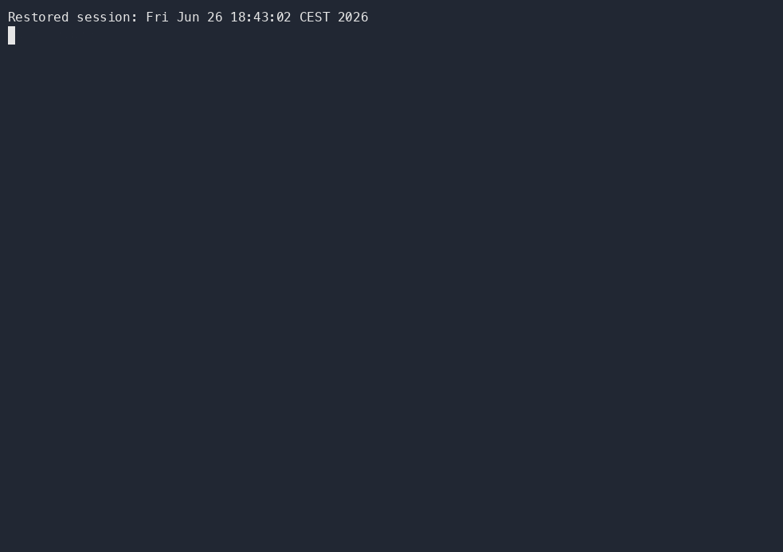

<!-- Copyright (c) Microsoft Corporation.
Licensed under the MIT License. -->

# Quickstart

## Bridge Kind beta — two setup commands

The source CLI now has an integrated cold-install route for the Bridge workspace (Teams, Missions, Inbox and catalogue), rather than only a sandbox chat:

```bash
npm install --global <verified-beta-cli-tarball-url>
kars dev --release --target local-k8s --beta-config
```

**Release status:** this route still needs a matching packaged CLI, qualified images and installed customer acceptance. The placeholder above must be replaced with that release's verified CLI tarball URL; it is not an executable published-version claim. Kind qualification comes first; AKS/Entra acceptance follows separately.

**Prerequisites:** Node.js 22+, Kind, kubectl, Helm **4.1.3**, OpenSSL, a running local Docker-compatible or Podman endpoint with enough capacity and loopback port 443 publishing, and legitimate Foundry/Azure OpenAI API-key access. Replace the install URL with the verified tarball from the matching signed release; this source change does not establish that a published release includes it. No existing cluster, Dex instance or beta input file is needed. Setup supplies the maintained Kind/Cilium versions and uses only packaged release charts/images, even inside a source checkout.

Bare `--beta-config` always prompts for initial inference and a new local beta email/password. It creates a uniquely named cluster and a genuine packaged Dex prerequisite, registers distinct Bridge/Headlamp clients, and generates fresh TLS and principal credentials. It asks explicitly before adding one owned loopback hostname and trusting its one-year, hostname-constrained CA. This requires sudo for `/etc/hosts`; macOS uses the login keychain, while Linux requires `update-ca-certificates` and system trust. Browsers using a separate trust store may need their own explicit trust decision. The CA signing key is destroyed after issuance. Declining consent creates no cluster or host-trust changes.

The local account receives the Bridge admin role through its actual email claim and prefixed Kubernetes `User` reader bindings for ordinary workloads, the maintained Kars dashboard resources (including SRE), nodes/namespaces and metrics; no Secrets reads, writes or groups are fabricated. Local beta uses an explicit empty price catalogue, unknown costs, actual usage accounting and freshly enrolled unbounded, non-expiring token allowances. Production finite-budget enforcement is unchanged. To retain external OIDC or unattended setup, supply `--beta-config ./kind-beta.yaml` and the [explicit-file inputs](../bridge/docs/public-beta-helm.md#integrated-kind-command).

Keep the printed private `.kars-kind-beta-<name>` directory. From the same working directory, `kars dev down --cluster-name <printed-name>` targets only the recorded immutable node at its original runtime endpoint, then removes its owned hostname/certificate. It never kills arbitrary port listeners or deletes by a reusable cluster name. Failure receipts remain private; no first-install identities are replayed. Ctrl+C closes owned UI tunnels without deleting the cluster or local trust.

The supplied Secret referenced by `inferenceBudget.tlsSecretName` must have type `kubernetes.io/tls`, both `tls.crt` and `tls.key`, and annotation `kars.azure.com/inference-budget-tls: v1`. Before creating the cluster, the CLI checks this broker identity metadata and verifies that the unexpired server certificate covers `kars-inference-budget.kars-system.svc`, matches its private key, and chains to `inferenceBudget.caBundle`. Supply the certificate chain when an intermediate CA is used. It does not silently adopt an unmarked Secret or replace mismatched trust. Keep the Kind profile's credential-free `workspaceEnrollment.enabled=true` in `kars-system`; do not carry an existing operator-managed workspace's disabled enrollment into this fresh install. The chart initially creates an empty grant. After Bridge installation, the CLI enrolls its actual ServiceAccount and the Core controller, creates the shared provider/settings and GitHub App stores without overwriting existing credentials, and qualifies private consumption including SRE. The empty App store makes later operator setup possible without a separate storage-permission repair; it does not configure a GitHub App or authorize any principal's repository access. Additional providers do not need to be known at installation. The initial provider comes from explicit Core settings, compatible saved credentials or the first-provider prompts; later connections are managed in Bridge Configuration.

Use fresh-install Core values: keep `schemaHook.enabled=true` (the Kind profile default), and omit the upgrade-only `sre.routerImageBaseline`, `sre.runtimeImageBaseline` and `missionDispatcher.imageBaseline` fields. Those fields bind an existing workspace's original images; they are not the images to install in a new workspace. Keep the selected qualified image references unchanged. Also omit `inferenceBudget.builtInFunding`, `inferenceBudget.tokenTopUps` and `inferenceBudget.unboundedTokenAllowances`, or supply empty lists: their records bind existing cluster/catalog/account identities and cannot fund a new cluster. Keep `sre.firstInstallFunding.unboundedTokens=true`; enrollment creates the allowance for the new identities. The CLI rejects carried-over settings before creating a cluster; Core also rejects image baselines and existing funding records during cold SRE enrollment.

The one Kind command configures API-server OIDC and checks the resulting API-server Pod for the reviewed issuer, audience, claims and read-only CA projection before installing workloads. Kind's kubeadm template uses v1beta3 map arguments; a mismatched patch version can otherwise be silently ignored. The command then installs Cilium, verifies the new Kind node's public kubelet certificate chain and hostname, provisions the reviewed prerequisites, then installs the maintained Core and Bridge releases. Metrics-server uses that node's CA and an explicit hostname mapping; kubelet TLS verification stays enabled. Trust is derived for each fresh cluster, not copied from another installation. Core owns AgentMesh, witness, Headlamp and first-install SRE funding/enrollment. Before installing Bridge, the CLI discovers Core's registered SRE consumer and waits for its Deployment rollout and authority readiness; the enrollment hook alone does not prove that startup credential migration has finished. A readiness failure retains Core without attempting Bridge or rolling anything back. After HTTP reachability checks the CLI opens Bridge, keeping both UI tunnels in the foreground. Sign in normally; no token-paste Headlamp step. Ctrl+C closes only those tunnels, retaining the cluster. See the linked guide for reconnecting without replaying first-install identities.

If provider initialization fails after Core and Bridge are installed, preserve the cluster and resume the same setup state instead of rerunning cold installation:

```bash
kars dev setup-providers --kind-cluster kars-beta \
  --kubeconfig .kars-kind-beta-kars-beta/kubeconfig \
  --state-directory .kars-kind-beta-kars-beta/provider-setup
```

For an older Kind beta installation that never initialized providers, this command uses the same setup path. It verifies the running Kind container, its Kubernetes CA and the installed `kind-beta` profile before changing authority. It does not apply to production or AKS. Keep the mode-0700 setup directory private: it retains recovery credentials, not just logs. Before retirement, setup brings the maintained admission policy up to date through a guarded Core Helm upgrade. The controller's exact live replica count, UID and resource version are preserved, including when resuming a paused controller. That fenced, paused upgrade defers default ToolPolicy hook replacement until the post-activation upgrade, because its finalizer requires the running controller; it never removes the finalizer manually. Credential-grant operators may pause unchanged reviewed Deployments and stamp only the qualified epoch on stopped consumers; they do not gain arbitrary workload-edit permission. Private-root retirement deliberately pauses affected consumers; a fresh budget TLS identity is issued only after verified retirement, then the public CA is persisted through the guarded Core upgrade. Interrupted attempts keep their identity and recovery state. Never delete that state to bypass an error. Bridge upgrades retain the enrolled grant rather than reset it to the chart's empty bootstrap. These source changes still require packaged and live customer qualification.

Normal Ctrl+C or SIGTERM shutdown waits for the owned UI tunnels to close and
returns successfully. After access is established, a lost-Pod/reset/EOF disconnect
reconnects only the affected tunnel on the same loopback port, leaving the other
UI available and rechecking HTTP before reporting recovery. Recovery retries for
up to three minutes without reopening the browser or changing authentication.
Startup failures, authorization errors, occupied ports, unexplained exits, and
exhausted recovery remain errors. None of these paths delete or reinstall the
cluster; Ctrl+C also cancels recovery.

## Standalone Core compatibility

For developers who want only a **standalone Core sandbox**, the existing two-command path below remains available — no Azure account, no Rust, no clone. It is **not the full Bridge beta workspace**.

<p align="center">
  
  <br />
  <em>First run on a local kind cluster (<a href="assets/kars-dev-firstrun.cast">replayable asciinema cast</a>).</em>
</p>

> 📋 **You need:** [`kind`](https://kind.sigs.k8s.io/) · [`kubectl`](https://kubernetes.io/docs/tasks/tools/) · [`Helm`](https://helm.sh/docs/intro/install/) · any container runtime (**Docker, Podman, or nerdctl** — kind drives all three) · [Node.js 22+](https://nodejs.org/) · a **GitHub Copilot** subscription, a **GitHub Models** PAT with `models:read`, or an existing **Azure AI Foundry / Azure OpenAI** deployment. The two setup commands assume these prerequisites are installed and the selected release images are accessible.

```bash
# 1. Install the published CLI
npm i -g @kars-runtime/cli

# 2. Start standalone Core and sandbox chat on Kind
kars dev --release --target local-k8s
```

On first run, `kars dev` asks you to pick an inference provider — for example, **GitHub Copilot** uses device-code login without an Azure account. It starts the sandbox and opens its chat when the gateway token is available. Reopening chat later is an **optional interaction**, not a third setup command:

```bash
kars connect dev-agent
```

Kind uses the separate agent/router pod shape, but that does not establish AKS or production parity. In particular, a default Kind cluster does not prove NetworkPolicy enforcement. This source documentation update does not publish a new CLI or images, or verify a clean-machine customer start.

> ⚡ **Even faster, less faithful.** Drop `--target local-k8s` to run a single container instead of a kind cluster (`kars dev --release`). It's the quickest path to a chat, but it co-locates the agent and router — not the production pod shape. This path uses the `docker` CLI specifically.

## What just happened?

`kars dev --release --target local-k8s` requests published images and installs Core with its local-development overlay. It creates the sandbox with an agent (UID 1000) and inference router (UID 1001) in separate containers, an `egress-guard` init container and a `NetworkPolicy`. Model credentials are held by the router rather than exposed to the agent. Headlamp and monitoring are optional, best-effort additions; Headlamp's token-paste login is not Bridge SSO. See [Architecture → Two modes](architecture.md#two-modes) for the isolation boundaries.

## Beta policy and validation boundary

Use `--beta-config` for the maintained two-product-release bootstrap; omitting it intentionally retains standalone Core behavior. The CLI asset bundler now includes both `deploy/helm/kars` and `bridge/deploy/helm/kars-bridge`. Bare `--beta-config` provisions packaged Dex as an owned prerequisite; an explicit input file continues to require reachable external HTTPS OIDC. Full Bridge still rejects its legacy bundled-Dex mode. No identity, private-root or tenant-isolation controls are bypassed.

The maintained Kind beta overlay selects `sre.firstInstallFunding.unboundedTokens: true`, with no token cap or expiry. Its cold hook binds the real account identity, publishes the existing digest-bound allowance and waits for controller consumption; actual usage accounting remains enabled. Explicit finite policies remain available outside beta.

Passing local tests, chart rendering, pod readiness or UI HTTP checks is not customer acceptance. Clean-machine package installation, genuine OIDC permissions/denials, Cilium enforcement and all exposed workflows still require installed Kind qualification with the matching images. AKS/production parity is not claimed.

## Next steps

- 🔰 **Go deeper on local dev** → [Getting started](getting-started.md) — provider options (Foundry, GitHub Models), building from source, and the full local walkthrough.
- ☁️ **Run it on AKS** → [Getting started → Deploy to AKS](getting-started.md#step-2--deploy-to-aks) — `kars up` provisions the cluster, controller, and your first sandbox.
- 🧭 **Understand the design** → [Architecture](architecture.md) and the [architecture diagrams](architecture-diagrams.md).
- 📊 **Check feature status** → [Feature maturity](maturity.md) — what's GA, preview, and planned.
